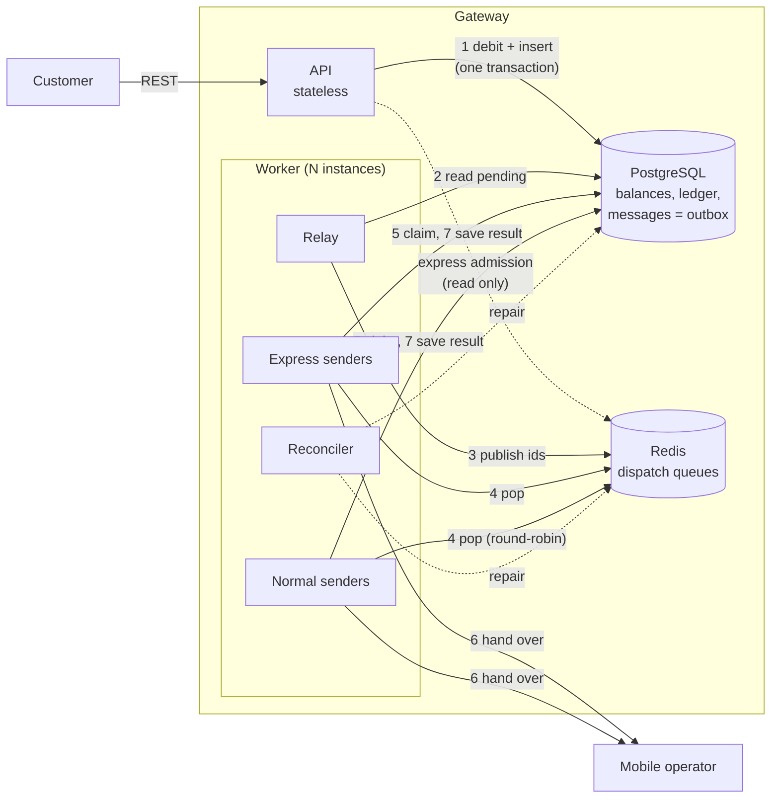
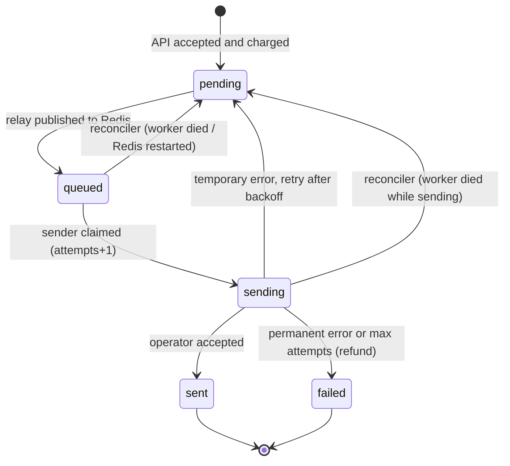
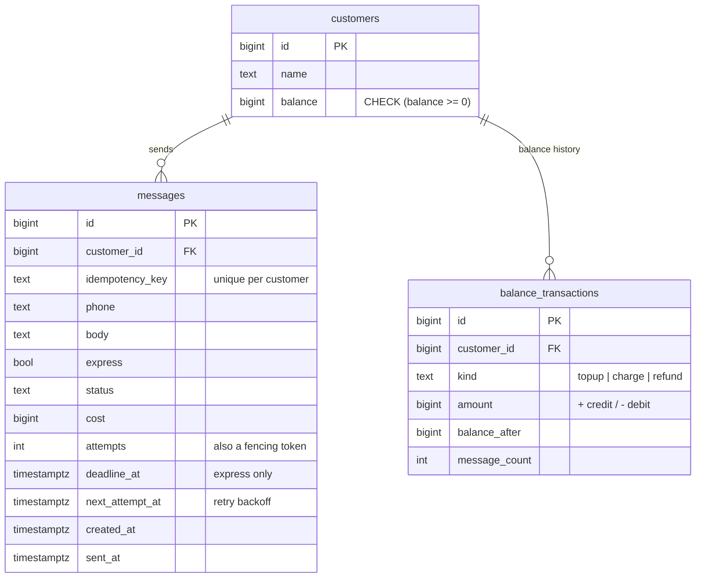

# Architecture

This document describes how the SMS gateway works and why it is built this
way. The short version of every decision is in [decisions.md](decisions.md).

- [1. Requirements](#1-requirements)
- [2. Capacity estimate](#2-capacity-estimate)
- [3. Overview](#3-overview)
- [4. Message lifecycle](#4-message-lifecycle)
- [5. Data model](#5-data-model)
- [6. How each requirement is met](#6-how-each-requirement-is-met)
- [7. Failure handling](#7-failure-handling)
- [8. Scaling to 100M messages per day](#8-scaling-to-100m-messages-per-day)
- [9. What is not built](#9-what-is-not-built)

## 1. Requirements

From the challenge:

1. Tens of thousands of businesses send ~100 million SMS per day, which we forward to mobile operators.
2. Traffic is very uneven: some customers send at very high rates, most at low rates.
3. **Express SMS** (e.g. OTP): customers get a guaranteed time limit for hand-over to the operator.
4. Customers can use their **entire** balance, and nothing is accepted once it is exhausted.
5. Customers can get reports of their sent messages.

Assumptions (given): no auth or user management, one segment per SMS, Persian
and English cost the same, REST only.

My own assumptions:

- "Hand-over" means the operator accepted the message. Delivery to the
  phone (delivery reports) is out of scope.
- A customer pays when the message is **accepted**, and gets the money back
  if we finally fail to hand it over. So the customer only pays for what
  the operator received.
- Express costs more than normal (configurable), because it uses reserved capacity.

## 2. Capacity estimate

| | |
|---|---|
| Average rate | 100M / 86,400 s ≈ **1,160 msg/s** |
| Peak rate | traffic follows business hours; assume 5-10x → design for **~10,000 msg/s** |
| Storage | ~300 bytes per message incl. indexes → **~30 GB/day**, ~1 TB/month |
| Operator side | the operator call is the slow part (tens to hundreds of ms), so throughput comes from **concurrency**: at 50 ms per call, 10k msg/s needs ~500 concurrent sends |

Consequences:

- The API and workers must be stateless and scale horizontally.
- The balance check must be cheap and correct under concurrency.
- Long-term reporting data does not belong in the same hot tables forever
  (see [section 8](#8-scaling-to-100m-messages-per-day)).

## 3. Overview



**Two processes**, both stateless, both can run many copies:

| Component | Job |
|---|---|
| **API** (`cmd/api`) | Validates the request, checks express admission, then in **one Postgres transaction** stores the message and debits the balance. Returns `202 Accepted`. It never talks to the operator. |
| **Relay** (in `cmd/worker`) | Moves new messages (`pending`) from Postgres into the Redis queues. This is the *transactional outbox* pattern. |
| **Senders** (in `cmd/worker`) | Pop message ids from Redis, claim them in Postgres, hand them to the operator, save the result. Express and normal have **separate goroutine pools**. |
| **Reconciler** (in `cmd/worker`) | Every 10s, finds messages stuck because a process or Redis died, and puts them back on track. |

**Two data stores, with clear roles:**

- **PostgreSQL is the source of truth.** Balances, ledger and every message
  live here. Money needs ACID transactions.
- **Redis only holds scheduling state** (which message id is sent next). It
  is fast and has the data structures (lists, sets, atomic Lua scripts) to
  build a fair scheduler. Everything in Redis can be rebuilt from Postgres,
  so losing Redis delays messages but never loses them.

### The send path step by step

1. `POST /v1/customers/{id}/messages` → service validates phone and text,
   for express runs admission control, computes the price and deadline.
2. Store, in one transaction: insert the message (`pending`), debit the
   balance with a conditional `UPDATE`, write a ledger row. Commit.
3. API answers `202` with the message id. The message is now safe on disk.
4. Relay (`SELECT ... FOR UPDATE SKIP LOCKED`) picks pending messages,
   pushes their ids to Redis, marks them `queued`, commits.
5. A sender pops ids (express list, or the next customer's turn in the
   round-robin), claims them in Postgres (`sending`, attempts+1), and acks
   them in Redis.
6. Sender calls the operator with a timeout.
7. Result is saved: `sent`, or back to `pending` with a backoff time
   (temporary error), or `failed` + refund (permanent error or too many attempts).

## 4. Message lifecycle



At any moment exactly one place is responsible for a message:
Postgres (`pending`), Redis (`queued`), or one worker (`sending`). The
reconciler watches every hand-off between them (see [section 7](#7-failure-handling)).

## 5. Data model



Indexes are chosen per query:

| Index | Used by |
|---|---|
| `messages (customer_id, id DESC)` | reports, keyset pagination |
| `messages (customer_id, idempotency_key)` unique, partial | idempotent retries |
| `messages (express, next_attempt_at, id) WHERE status='pending'` | relay; tiny because it only contains waiting rows |
| `messages (status, updated_at) WHERE status IN ('queued','sending')` | reconciler |

Money is always `BIGINT` in the smallest currency unit, never a float.

## 6. How each requirement is met

### 6.1 Balance: use all of it, never more

The whole rule is one SQL statement:

```sql
UPDATE customers SET balance = balance - $cost
WHERE id = $customer AND balance >= $cost
RETURNING balance;
```

- The check and the debit happen **atomically**. Postgres locks the row,
  so two concurrent requests of the same customer run one after the other;
  the second sees the balance left by the first.
- `balance >= cost` allows the last message to bring the balance to exactly
  **zero** (the customer uses the whole balance), and zero rows updated means
  "insufficient balance" → `402`.
- A naive `SELECT balance` followed by `UPDATE` would let two requests both
  see enough money and overspend. This is tested: 200 parallel sends with
  money for exactly 50 → exactly 50 accepted, balance 0
  (`TestAcceptNeverOverspendsUnderConcurrency`).
- `CHECK (balance >= 0)` on the table is a safety net against any future bug.

Around that statement:

- **Same transaction as the insert.** The message rows and the debit commit
  together or not at all. A bulk request of 1000 messages is all-or-nothing.
- **Ledger.** Every top-up, charge and refund adds a row to
  `balance_transactions`, so the balance can always be explained and checked
  (`balance = SUM(amount)`, asserted in the tests).
- **Refunds.** A message that finally fails is refunded in the same
  transaction that marks it failed. The update is guarded
  (`WHERE status = 'sending' AND attempts = $n`) and only rows that really
  changed are refunded, so a refund can never happen twice.
- **Idempotency.** If a client times out and retries with the same
  `Idempotency-Key`, the unique index makes the insert a no-op and we return
  the original message. The customer is never charged twice. Reusing a key
  for a different message returns `409`.

### 6.2 Uneven traffic: fairness between customers

If all normal messages were in one FIFO queue, a customer who sends a
campaign of 1 million messages would block everyone behind it for hours.

Instead, Redis keeps **one queue per customer** and a **ring** of customers
that have messages waiting:

```
ring:                 [ heavy, light ]
queue:heavy           [ 1 2 3 4 5 ... 1000000 ]
queue:light           [ 7001 7002 ]
```

A sender takes the next customer from the ring, pops at most
`FAIR_QUANTUM` (10) of its messages, and moves the customer to the back of
the ring if it still has messages. This is **round-robin fair queuing**.
All of it runs in a Lua script, so it is atomic even with hundreds of
senders popping at once (`internal/queue/scheduler.go`).

The guarantee: with `C` customers waiting, a new customer's message waits
for at most one round, `C × quantum` messages, no matter how big anyone's
backlog is. The demo shows it: 50 messages from a small customer are handed
over in < 1s while 20,000 messages from a big customer were queued before them.

Notes:

- Heavy customers are not punished: when nobody else is sending, they get
  the full capacity.
- Weighted fairness (paid plans with a bigger share) only needs a
  per-customer quantum. Not built, but the structure supports it.
- The relay itself is FIFO. That is fine because it only moves ids from
  Postgres to Redis and is much faster than the operator (thousands of
  rows per second), so the backlog builds up in Redis, where the fair
  scheduler works.

### 6.3 Express SMS: a time limit we can keep

A latency promise is only possible if the amount of work in front of a
message is bounded. So the design has two halves: **reserve capacity** and
**limit what we accept**.

Reserved capacity (isolation):

- **Separate queue.** Express ids go to their own Redis list. They never
  wait behind normal messages.
- **Separate senders (bulkhead).** Express has its own goroutine pool. A
  flood of normal traffic, or a slow operator response on normal traffic,
  cannot occupy express senders.
- **Fast paths.** The express relay polls every 20ms (normal: 200ms) and
  express senders poll every 10ms and take one message at a time. Retries
  back off for 100ms, not seconds.

Admission control (refuse what we can't do in time):

- **Global backlog cap.** If `EXPRESS_MAX_BACKLOG` express messages are
  already waiting, a new one is refused with `503` + `Retry-After` and
  **nothing is charged**. The cap is sized as
  `express throughput × SLA budget`. Example: 2 workers × 20 senders at 50ms
  per call = 800 msg/s; with a 5s SLA and a 50% safety margin,
  800 × 2.5s = 2,000.
- **Per-customer rate limit.** `EXPRESS_RATE_PER_CUSTOMER` per second
  (`429` above it), so one customer cannot use up the capacity everyone
  else's OTPs need.
- If Redis is down, express fails **closed** (`503`): we cannot promise
  what we cannot track. Normal messages are still accepted, because the
  API only needs Postgres for them.

Visibility:

- Every express message gets `deadline_at = accepted_at + EXPRESS_SLA`,
  returned to the client.
- Workers export `sms_handover_seconds{lane="express"}` (histogram) and
  `sms_express_sla_missed_total`, so we can alert before customers notice.

Measured: p95 90ms, max 210ms, 0 missed, with a 20,000 message backlog on
the normal lane at the same time.

### 6.4 Reports

| Endpoint | Purpose |
|---|---|
| `GET /v1/customers/{id}/messages` | List, newest first. Filters: `status`, `from`, `to`. Paginated with a cursor. |
| `GET /v1/customers/{id}/messages/{messageID}` | Status of one message, attempts, last error, timestamps |
| `GET /v1/customers/{id}/messages/summary` | Count per status in a time range (default: last 24h) |
| `GET /v1/customers/{id}/transactions` | Balance ledger: top-ups, charges, refunds |

Pagination is **keyset** (`WHERE id < cursor ORDER BY id DESC`), not
`OFFSET`. With `OFFSET 1000000` the database must read and skip a million
rows; with a cursor every page costs the same, which matters for customers
with millions of messages.

## 7. Failure handling

Delivery to the operator is **at-least-once**; charging is
**exactly-once**. Every failure below was considered:

| What fails | What happens | How it is handled |
|---|---|---|
| Client times out and retries | Same request twice | `Idempotency-Key`: second request returns the first message, no second charge |
| API crashes mid-request | Transaction not committed | Nothing stored, nothing charged |
| Redis is down | Relay cannot publish | Messages wait as `pending` in Postgres; API still accepts normal messages; express refused (`503`) |
| Relay crashes after publishing, before commit | Rows stay `pending` | Published again later; the duplicate id is harmless because a message can only be claimed once |
| Sender pops an id before the relay committed | Row still `pending` | The claim also matches due pending rows, so Postgres waits for the relay's row lock and then claims it (found by testing, see `TestClaimWaitsForRelayCommit`) |
| Sender crashes after pop, before claim | Id gone from the Redis list | Popped ids are kept in an in-flight set (like an SQS visibility timeout); after 30s the reconciler puts them back to `pending` |
| Sender crashes after claim (`sending`) | No result saved | After `SENDING_TIMEOUT` the reconciler retries the message. The operator may get it twice: this is where at-least-once comes from |
| A late result arrives after the retry was started | Two workers report | Results are only saved if `attempts` still matches (a fencing token); the stale result is ignored, no double refund |
| Redis restarts or fails over | Queues may be lost | Reconciler notices the new Redis `run_id` and, in one transaction, puts all `queued` messages back to `pending`; the relay rebuilds the queues |
| Operator temporary error / timeout | | Retry with exponential backoff (normal 2s→5m, express 100ms→1s), up to `MAX_ATTEMPTS` |
| Operator permanent error / attempts used up | | `failed` + refund |
| Postgres is down | | API returns `500`, readiness probe fails, nothing is accepted. Postgres needs a replica with automatic failover (Patroni or a managed service) |

Graceful shutdown: on `SIGTERM` the API stops accepting connections and
finishes in-flight requests; workers stop popping and finish the batch they
are sending.

## 8. Scaling to 100M messages per day

The implementation runs on one Postgres and one Redis. This is how each part
grows to the full load (~10k msg/s at peak):

| Part | How it scales |
|---|---|
| API | Stateless: add instances behind a load balancer. |
| Workers | Stateless: add instances. Throughput ≈ instances × senders / operator latency. All coordination is through `SKIP LOCKED` and atomic Redis scripts. |
| Balance row contention | One customer's requests serialize on its row (~1-2k transactions/s per customer). The bulk endpoint charges 1000 messages with one update. Beyond that: split a big customer's balance into several sub-balances, or pre-reserve a block of credit in Redis and settle it in Postgres. |
| Postgres writes | Each message costs 1 insert + 3 small updates, done in batches. At 10k msg/s that is ~40k row writes/s, about the limit of one primary. Next steps, in order: (1) partition `messages` by day so old data is dropped cheaply and indexes stay small; (2) move the hot dispatch state into its own small table so the big history table gets one insert and one update per message; (3) shard by `customer_id` (each shard has its own relay and Redis). |
| Reports | Read replicas for the API's report queries. For analytics over months (100M rows/day), stream changes (CDC, e.g. Debezium) into a column store such as ClickHouse and serve summaries from there. |
| Redis | Holds only ids: 10M waiting messages ≈ 1 GB. All keys share the `{sms}` hash tag, so it runs on one Redis Cluster slot today; to grow, shard per customer group with one ring per shard. |
| Operators | Real gateways connect to several operators (MCI, Irancell, RighTel) and route by number prefix, each with its own TPS limit. The `Operator` interface is where routing and per-operator rate limiting go. |

Alternatives considered for the queue (details in [decisions.md](decisions.md)):

- **Kafka**: great throughput and durability, but partitions are FIFO, so a
  heavy customer blocks everyone on its partition. Fairness would need extra
  topics or consumer-side scheduling. Also more to operate.
- **RabbitMQ**: priority queues help express, but one queue per customer
  for tens of thousands of customers is heavy.
- **Postgres only** (`SKIP LOCKED` as the queue): simplest, but fair
  round-robin across customers in SQL is awkward and expensive at this volume.

## 9. What is not built

Out of scope for the challenge, but the design leaves room for them:

- Authentication (API keys per customer); today the customer id is in the path.
- Delivery reports (DLR) from the operator → a `delivered` status and webhooks to customers.
- Several operators with routing and per-operator TPS limits.
- Weighted fairness for paid plans; per-customer TPS limits on the normal lane.
- Multi-segment (concatenated) messages.
- Tracing (OpenTelemetry) and alert rules for the metrics.
